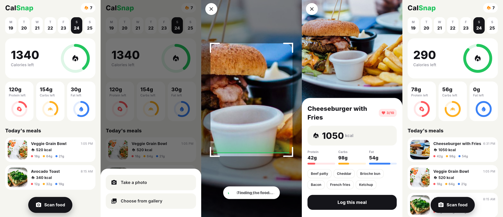

# CalSnap: AI Calorie Scanner in Flutter

Snap a photo of your meal and Gemini AI tells you the calories, protein, carbs, fat, a health score and the main ingredients. A Cal AI style app built in Flutter.



## Run it

1. Get a free Gemini API key at https://aistudio.google.com/apikey
2. Add the platform folders and get packages:

```bash
flutter create .
flutter pub get
```

3. Run with your key (never put the key in the code):

```bash
flutter run --dart-define=GEMINI_API_KEY=your_key_here
```

## What's inside

- `lib/services/food_ai.dart`: sends the photo to Gemini with a JSON schema and parses the nutrition reply
- `lib/screens/home_screen.dart`: daily calorie ring, macros and meal log
- `lib/screens/scan_screen.dart`: camera or gallery photo, scanning animation, result sheet
- `lib/widgets/`: ring, count-up numbers, macro cards, meal tiles, scan overlay

Packages: `http`, `image_picker`.

Video: Orhan Yazdan on YouTube.
